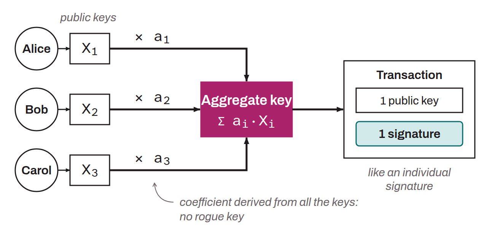

N-of-n Schnorr multisignature protocol proposed in 2018 by Gregory Maxwell, Andrew Poelstra, Yannick Seurin, and Pieter Wuille. It aggregates the public keys of several signers into a single key and produces a single valid signature, indistinguishable on the blockchain from an individual signature. To counter the rogue key attack, in which a participant manipulates their public key to control the aggregate key alone, the protocol multiplies each key by a coefficient derived from the set of all the keys.

The signing process takes place in three rounds of communication: exchange of cryptographic commitments to the nonces, revelation of the nonces, then exchange of the partial signatures. This three-round structure protects against nonce manipulation attacks, but imposes a demanding interactivity. MuSig was superseded by MuSig2, which brings the process down to two rounds.
