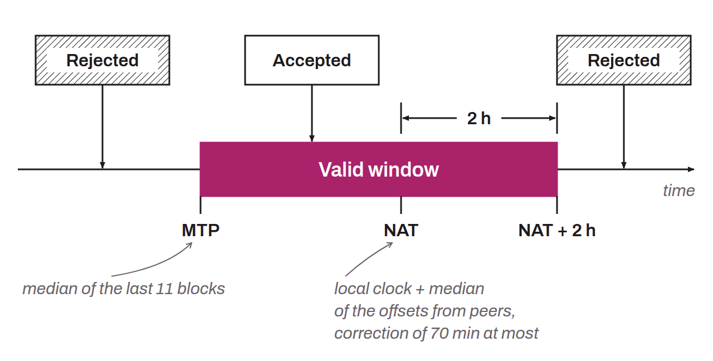

Estimate of universal time established from the clocks of the network's nodes. Each node computes its NAT by taking the median of the time differences between its local clock (UTC) and those of the nodes it is connected to, then adding this median to its local clock, up to a maximum of 70 minutes. Network-adjusted time is therefore a median of node times, computed locally by each node. Up to Bitcoin Core 26, this reference was used to check the validity of block timestamps: for a block to be accepted by a node, its timestamp had to fall between the MTP (the median time of the last 11 mined blocks) and the NAT plus 2 hours:



```text
MTP < valid timestamp < (NAT + 2h)
```

Since Bitcoin Core 27.0, the NAT has been removed from the consensus code and replaced by the node's unadjusted system time: the bound is now the system time plus 2 hours. The node still measures the median offset from its peers, but only to display a warning once the offset reaches 70 minutes.
