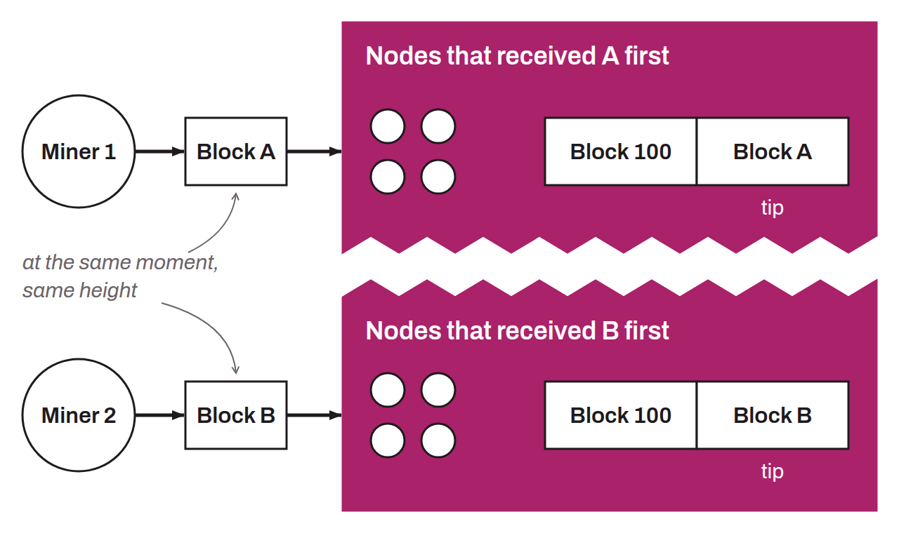

Temporary split of the blockchain resulting from the near-simultaneous broadcast of several blocks by different miners at the same height. This situation occurs when two blocks, designated $A$ and $B$, are found almost simultaneously, causing a temporary division of the network. Because each node considers the first block it received valid, but not everyone received the same block first, some of the nodes follow the chain containing block $A$ while the others follow the one with block $B$. This fork is resolved when one of the two competing chains pulls ahead of the other in accumulated work. At that point, all the nodes in the network automatically agree on the chain with the most accumulated work, a process called a chain reorganization, or reorg. These natural forks are inherent to Bitcoin's distributed operation. They are perfectly normal and resolve spontaneously after a few blocks (usually just one). If they are too frequent, these forks can still be harmful, because they waste computing power on a branch that ultimately becomes stale.

