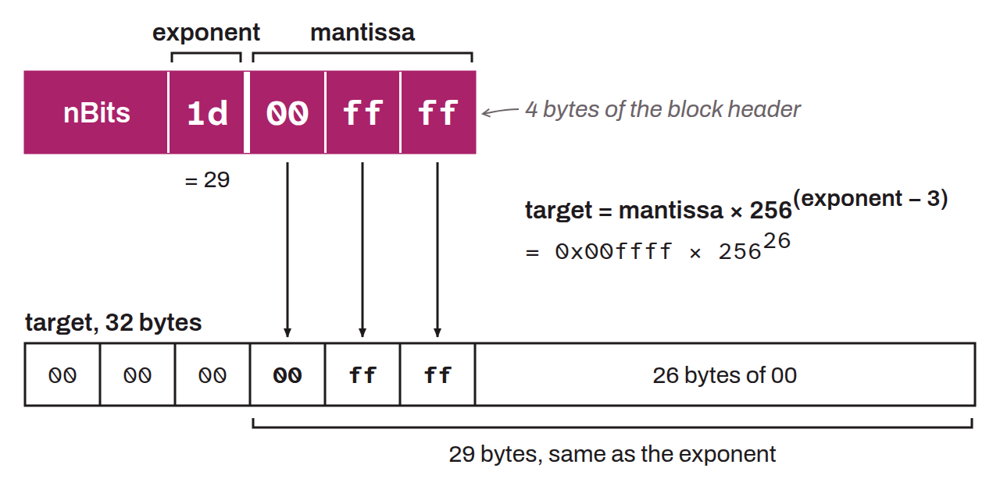

4-byte field present in the header of every Bitcoin block, which encodes the difficulty target in compact form: the first byte gives the number of bytes of the full target (the exponent), and the next three bytes make up the mantissa (the significant digits of the target). The decoding formula is: $target = mantissa \times 256^{(exponent - 3)}$.

A block hash must be lower than or equal to the target value encoded in `nBits` for the block to be considered valid. This field is recomputed every 2,016 blocks during the difficulty adjustment, in order to maintain an average interval of about 10 minutes between blocks.
