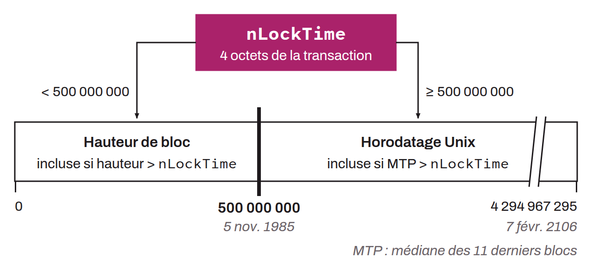

4-byte field built into every Bitcoin transaction, which specifies either an absolute block height (if its value is below 500,000,000) or an absolute Unix timestamp (if its value is greater than or equal to 500,000,000). The transaction is considered final (and therefore includable in a block) only once this value is strictly exceeded by the height of the candidate block (in height mode) or by the MTP, the median of the previous 11 blocks (in time mode). It is therefore an absolute timelock, as opposed to the relative timelocks of the `nSequence` field, and it applies to the whole transaction.

The `nLockTime` is enforced only if at least one input of the transaction has an `nSequence` different from `0xFFFFFFFF`. If all inputs have `nSequence = 0xFFFFFFFF`, the field is ignored entirely. This is why wallets that use `nLockTime` typically set `nSequence = 0xFFFFFFFE`.

`OP_CHECKLOCKTIMEVERIFY` complements this mechanism by making it possible to impose a timelock from a `scriptPubKey`. The opcode checks 4 conditions:
* the value at the top of the stack and the transaction's `nLockTime` are of the same type (block height or timestamp),
* the value at the top of the stack is not negative,
* the value at the top of the stack is less than or equal to the transaction's `nLockTime`,
* the `nSequence` of the input being evaluated is not `0xFFFFFFFF`.

CLTV therefore never checks time or height directly: it delegates this check by forcing the spending transaction to declare an `nLockTime` less than or equal to the value wanted by the script.
