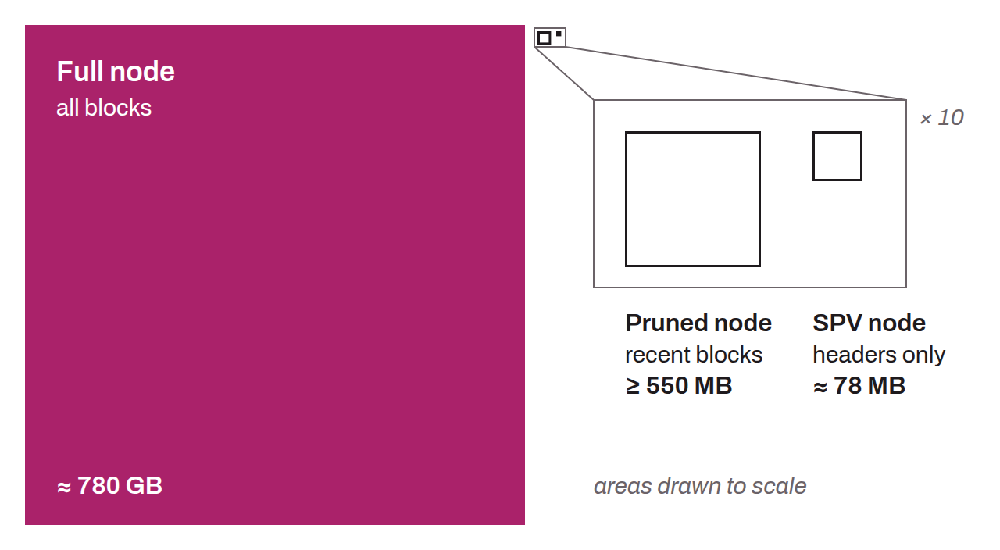

Computer that runs a Bitcoin protocol client (such as Bitcoin Core) on the Bitcoin network. It takes part in the network by maintaining a copy of the blockchain, relaying and validating transactions and new blocks, and, optionally, by participating in the mining process. The sum of all Bitcoin nodes makes up the Bitcoin network itself.

There are several types of nodes on Bitcoin, including full nodes and light clients. Full nodes keep a complete copy of the blockchain, validate all transactions and blocks according to the consensus rules, and actively take part in the propagation of transactions and blocks across the network. Light clients, or SPV (*Simplified Payment Verification*) nodes, on the other hand, keep only the block headers and rely on full nodes to obtain information about transactions.

*Some also distinguish so-called “pruned nodes”. These are full nodes that download and validate all blocks since the genesis block, but keep only the most recent blocks on disk.*
