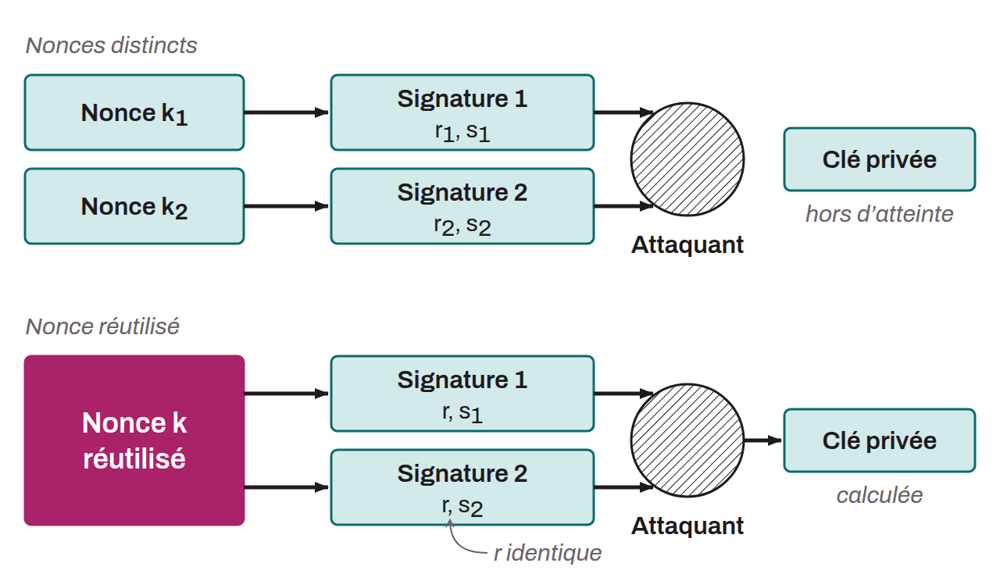

Number used only once, then replaced. It is often random or pseudorandom. It is used in various cryptographic protocols to guarantee the security of the process. For example, the ECDSA signatures used within the Bitcoin protocol involve the use of a nonce. This means that this number must be new for each signature. If it is not, the private key used can be computed by comparing two signatures that use the same nonce.

Nonces are also used in the mining process on Bitcoin. Miners increment these modifiable values within their candidate blocks. They change the value of the nonce in order to find a hash less than or equal to the difficulty target. This process requires a great deal of computing power, since it is an exhaustive search through a large number of possible nonces. When a miner finds a nonce that, once included in their block, produces a hash meeting the difficulty criteria, the block is propagated to the network, and the miner earns the reward.

*In 2010, researchers discovered that Sony's PlayStation 3 used the same nonce when signing different packages of code. This nonce reuse allowed attackers to compute the private key used to sign the software. With the private key in hand, the attackers could create valid signatures for any code, which let them run unauthorized software, including pirated games and custom operating systems, directly on the PS3.*

*There is a common misconception about the origin of the term “nonce”. Some claim that it is an abbreviation of “number only used once”. In reality, the word dates back to the 12th century and comes from the semantic evolution of the Middle English phrase “for then anes”, which meant “for this occasion”.*
