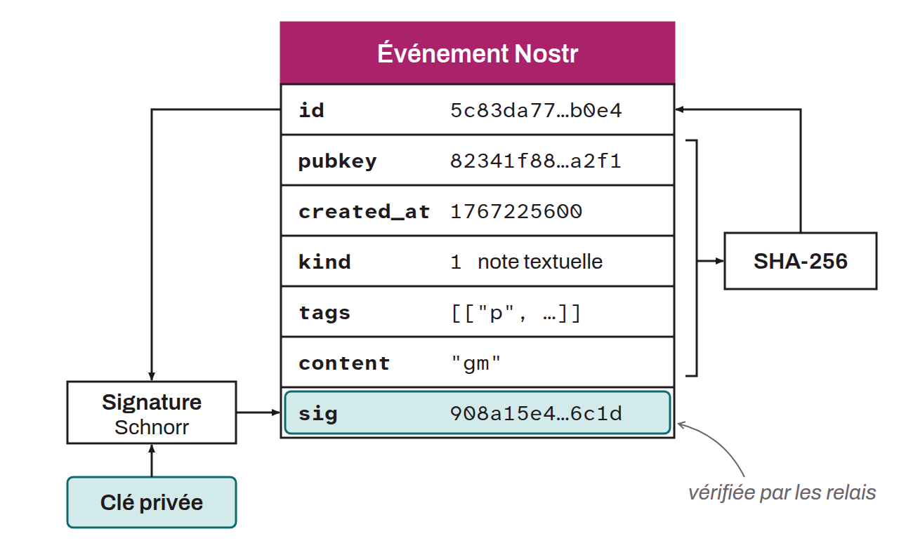

Fundamental unit of data in the Nostr protocol. All information transmitted over the Nostr network (text post, profile update, reaction, encrypted message, zap receipt...) takes the form of an event. An event is a JSON object containing seven fields:
* `id`: a unique identifier obtained by SHA-256 hashing of the serialized content,
* `pubkey`: the author's public key,
* `created_at`: the Unix timestamp,
* `kind`: the event type, identified by an integer,
* `tags`: structured metadata for mentioning users, referencing other events, or adding hashtags,
* `content`: the text content,
* `sig`: the Schnorr signature on secp256k1.

The `kind` field determines the nature of the event: kind 0 for profile metadata, kind 1 for text notes, kind 4 for encrypted direct messages, kind 7 for reactions, or kind 9735 for zap receipts. Relays verify the signature before accepting an event, which guarantees the authenticity and integrity of the data.

