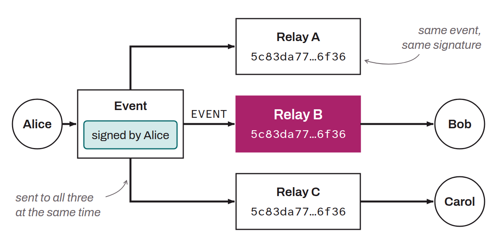

Server that forms the distribution infrastructure of the Nostr protocol. A relay accepts events published by clients over WebSocket connections, stores them (temporarily or permanently), and forwards them to subscribed clients according to query filters. Unlike a conventional centralized server, a relay cannot modify the content of the events it forwards, because they are cryptographically signed by their authors. Each relay applies its own moderation, storage, and access policies. In practice, several uses can be distinguished: public relays (open to all), private relays (restricted access), paid relays (requiring a subscription), or specialized relays (dedicated to certain types of content). These are not protocol categories: NIP-11 only lets a relay announce that it requires authentication (NIP-42) or payment. A Nostr user generally connects to several relays at once to ensure redundancy and censorship resistance.

