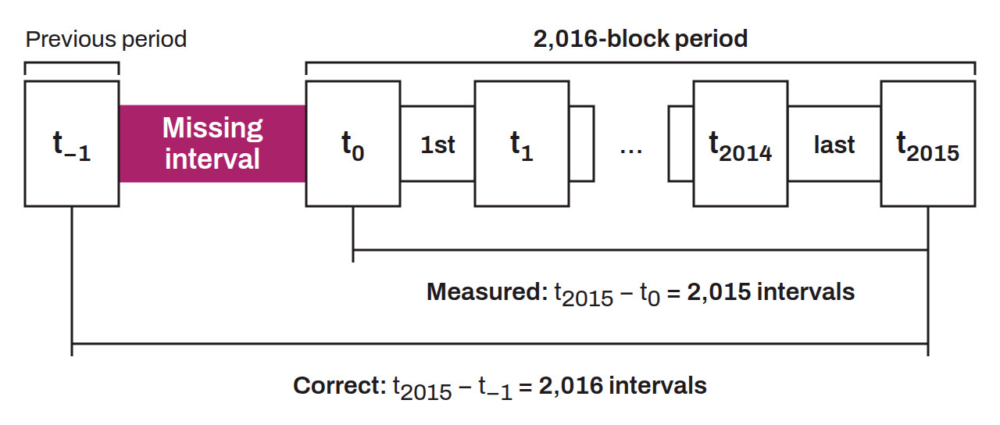

Logic error where a loop iterates one time too many or too few, often caused by a misuse of comparison operators or wrong indexes in the handling of data structures. Two notable instances of this bug exist in Bitcoin.

The most consequential one is found in the calculation of the difficulty adjustment. The algorithm measures the time elapsed during a period of 2016 blocks by comparing the timestamp of the first block of the period to that of the last, then compares this duration to the target time of $1{,}209{,}600$ seconds ($2016 \times 600$). The problem is that the difference between the first and the last block of a period covers only 2015 block intervals, not 2016:
$$T = t_{2015} - t_0$$

The intervals counted are:
$$\underbrace{[t_0 \to t_1]}_{1},\ \underbrace{[t_1 \to t_2]}_{2},\ \ldots,\ \underbrace{[t_{2014} \to t_{2015}]}_{2015}$$

That makes 2015 intervals. To get 2016, the last block of the previous period should have been used as the starting point:
$$T_{correct}\ =\ t_{2015}\ -\ t_{-1}$$

Where $t_{-1}$ denotes the timestamp of the last block of the previous period (block $n - 1$ for a period that starts at block $n$). The algorithm therefore compares 2015 real intervals to the theoretical time of 2016 intervals. This offset introduces a bias of about $\frac{1}{2016} \approx 0.05\,\%$ toward a slightly overestimated difficulty.

The main consequence of this bug is that retarget periods do not overlap: the timestamp of the last block of a period does not enter into the calculation of the next period. This discontinuity makes the time warp attack possible, in which an attacker holding a majority of the hashrate manipulates the timestamp of the last block of a period without affecting the calculation of the next period. Actually fixing this bug would require a hard fork, but time warp attacks can be prevented through a simple soft fork by adding constraints on timestamps.

The second instance of an off-by-one bug in Bitcoin is the dummy element in `OP_CHECKMULTISIG`, where the opcode consumes an extra stack element by mistake. This bug was effectively fixed by BIP-0147 (NULLDUMMY), which requires this element to be a null value.
