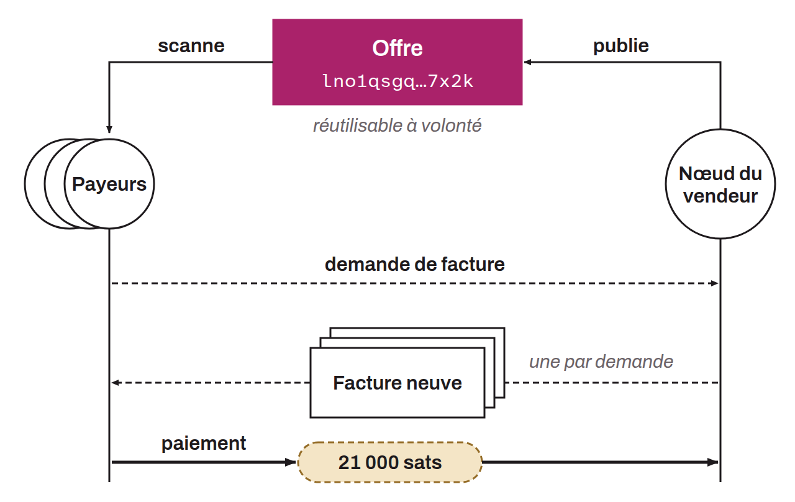

Reusable string defined in BOLT-12, which can be carried in a QR code, used to make several payments on the Lightning Network. Unlike regular invoices, offers can be reused. They allow several invoice requests to be generated. When a user scans an offer (for example via a QR code), they send a message to request a new invoice from the associated Lightning node. The node responds with an invoice that the payer can use. Offers thus provide a single identifier to receive many payments from many different users on Lightning.

