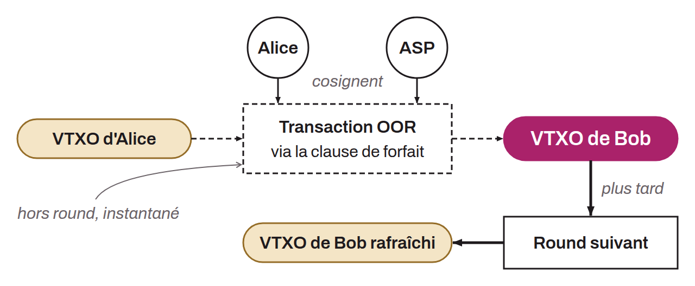

Instant payment mechanism within the Ark protocol that makes it possible to transfer VTXOs between users without waiting for the next round. Since Ark rounds are infrequent (15 to 60 minutes) and require liquidity from the ASP, OOR payments offer a fast and less costly alternative for routine transfers.

To make an OOR payment, the sender creates a transaction that reuses the forfeit clause of the VTXO's policy, which redirects the VTXO to a new VTXO owned by the recipient. The ASP co-signs this transaction, then the sender passes it to the recipient. The resulting OOR VTXO has the same properties as a regular VTXO: it can be used as an input in a round or serve for a new OOR payment.

The trust model differs, however, from payments made in a round. The recipient of an OOR payment must trust the sender and the ASP not to collude to carry out a double spend. In case of fraud, the signatures of both spends become public, which allows the recipient to prove the violation cryptographically. The user can at any time submit their OOR VTXO in the next round to refresh it into a regular, fully trustless VTXO.

OOR payments are sometimes referred to as “arkoor”.
