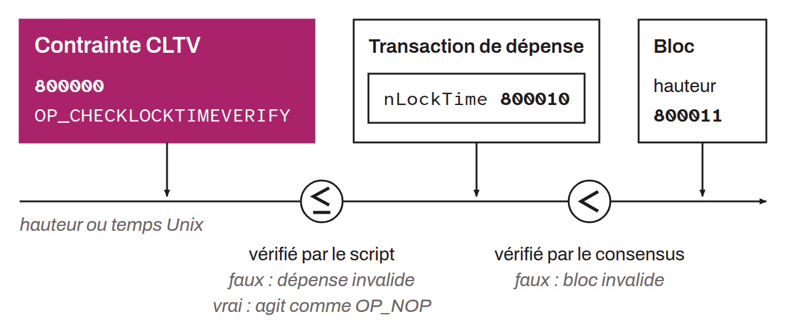

Makes the transaction invalid unless all of these conditions are met:
* The stack is not empty;
* The value at the top of the stack is greater than or equal to `0`;
* The timelock type is the same for the `nLockTime` field and the value at the top of the stack (real time or block number);
* The `nSequence` field of the input is not equal to `0xffffffff`;
* The value of the transaction's `nLockTime` field is greater than or equal to the value at the top of the stack.

If even one of these conditions is not met, the script containing the `OP_CHECKLOCKTIMEVERIFY` cannot be satisfied. If all of these conditions hold, `OP_CHECKLOCKTIMEVERIFY` acts as an `OP_NOP`, that is, it does nothing to the script. It is as if it disappeared. `OP_CHECKLOCKTIMEVERIFY` therefore imposes a time constraint on spending the UTXO secured by the script that contains it. It can do so either as a date expressed in Unix time or as a block number. To do this, it restricts the possible values of the `nLockTime` field of the transaction that spends it, and that `nLockTime` field in turn restricts when the transaction can be included in a block.

*This opcode is a replacement for `OP_NOP`. It was placed on `OP_NOP2`. It is often referred to by its acronym, “CLTV”. Note that `OP_CLTV` must not be confused with the `nLockTime` field of a transaction. The former uses the latter, but their natures and actions are different.*
