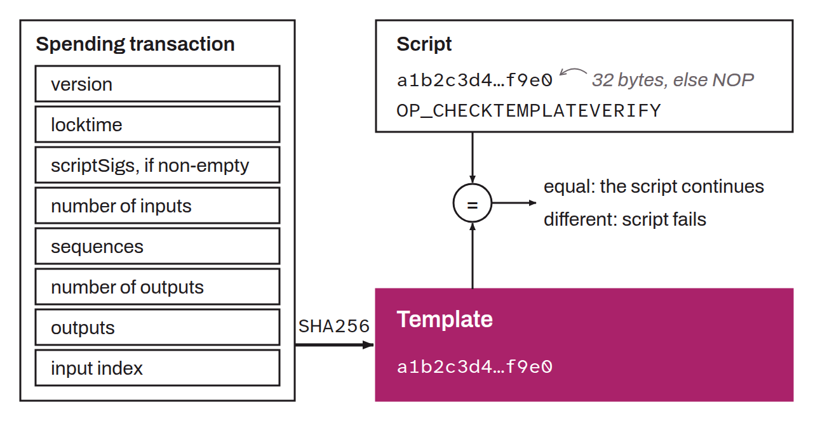

Opcode `0xb3` proposed in BIP-0119, replacing `OP_NOP4`. It requires the spending transaction to match a predefined template exactly, which makes it a non-recursive covenant mechanism.

The opcode reads the item at the top of the stack without removing it. If this item is 32 bytes long, it is compared with the `DefaultCheckTemplateVerifyHash` computed from the current transaction and the index of the input being executed. This hash is the `SHA256` of the serialized concatenation of: the transaction version, the locktime, the hash of the scriptSigs (if they are non-empty), the number of inputs, the hash of the sequences, the number of outputs, the hash of the outputs, and the index of the current input. If the two values do not match, the script fails. If the item is not 32 bytes long, the opcode behaves like an `OP_NOP` to allow future extensions.

By constraining nearly all the fields of the spending transaction, CTV makes it possible to specify the exact outputs in advance without relying on signatures or ephemeral keys. This property opens the way to applications such as payment trees for congestion control, vaults, joinpools, or more efficient DLCs. This proposal is still in Draft status in the BIP repository as of October 2026.
