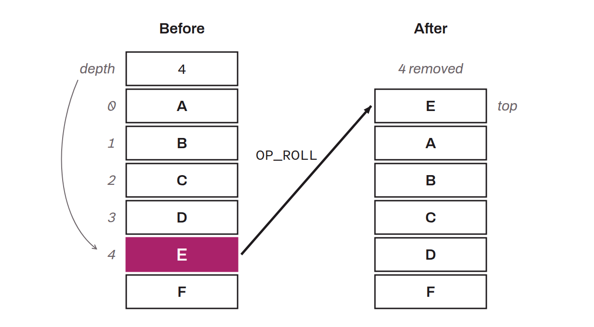

Moves an item of the stack to the top of the stack, based on the depth specified by the value at the top of the stack before the operation. For example, if the value at the top of the stack is `4`, `OP_ROLL` selects the fifth item of the stack counting from the top (indexing starts at `0`) and moves that value to the top. `OP_ROLL` plays the same role as `OP_PICK`, except that it removes the item from its original position.

