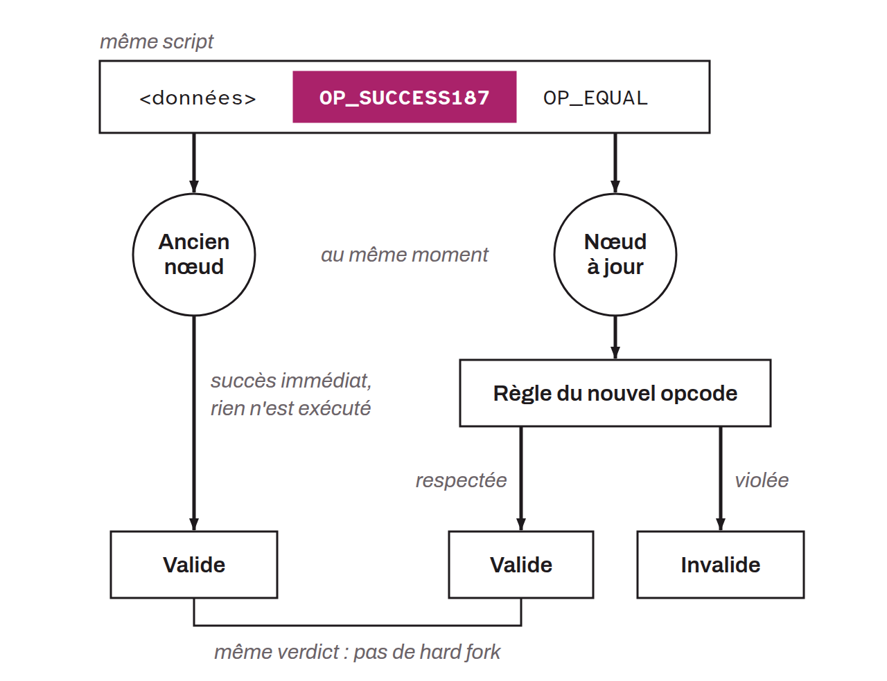

The `OP_SUCCESS` opcodes are a series of opcodes, disabled in the past or never defined (such as those numbered 187 to 254), that are reserved for future use in Tapscript. Their ultimate purpose is to make upgrades and extensions of the Script language easier, by allowing new features to be introduced through soft forks. As soon as one of these opcodes appears in a script, even in a branch that would never be executed, the script is unconditionally valid, regardless of the data or conditions present. This check comes before any execution: the script is directly considered valid.

Thus, when a new opcode is added on top of an `OP_SUCCESS`, it necessarily amounts to adding a rule that is more restrictive than the previous one. Upgraded nodes can then enforce this rule, and nodes that have not upgraded will not reject the associated transactions and the blocks that include them, because the `OP_SUCCESS` makes that part of the script valid. There is therefore no hard fork.

By comparison, `OP_NOP` (No Operation) opcodes also serve as placeholders in the script, but they have no effect on its execution. When an `OP_NOP` is encountered, the script simply continues without changing the state of the stack or the flow of the script. The main difference is therefore their impact on execution: `OP_SUCCESS` makes the entire script succeed immediately, whereas `OP_NOP` is neutral and affects neither the stack nor the script flow. These opcodes are named `OP_SUCCESSN`, where `N` is a number that distinguishes the `OP_SUCCESS` opcodes from one another.
