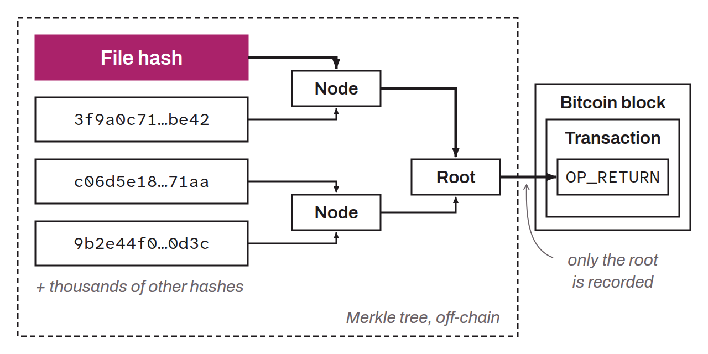

Open-source decentralized timestamping protocol, developed by Peter Todd. OpenTimestamps uses the Bitcoin blockchain to prove the existence of a document or piece of data at a specific point in time. The protocol computes a cryptographic hash of the file to be timestamped, then anchors that hash in a Bitcoin transaction by means of a Merkle tree. The result is a proof that can be verified and cannot be altered, showing that the data existed when the corresponding Bitcoin block was mined. This system is useful for intellectual property, contracts, legal evidence, or any situation that requires proof of time.

