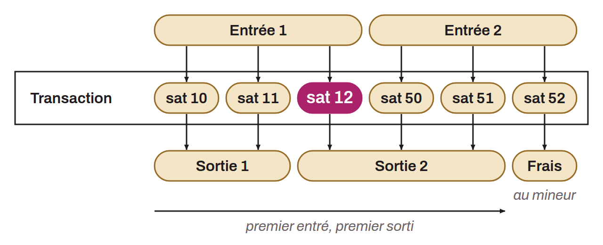

Protocol external to Bitcoin that assigns serial numbers to sats (the smallest unit of bitcoin), which make it possible to trace them individually and transfer them through Bitcoin transactions. According to Ordinals theory, each sat is numbered according to the order in which it was mined and is transferred on a first-in-first-out (FIFO) basis. The goal of this theory is to make sats non-fungible through their interpretation within the Ordinals protocol, in order to associate information with them, such as images (NFTs), known as “inscriptions”.

