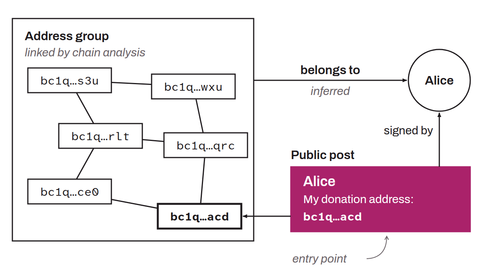

Acronym for *Open Source Intelligence*. OSINT refers to the collection and analysis of publicly available information from sources accessible to everyone. These sources can include websites, forums, social networks, public databases, academic publications, government documents, and so on. The main goal of OSINT is to turn raw data into actionable information by identifying trends, correlations, and investigative leads.

In the context of Bitcoin, OSINT can be used to support chain analysis to trace funds, notably to identify an entry point, that is, a link between on-chain activity and some form of identity belonging to a real entity. For example, if someone publishes their receiving address on Twitter under their own name, an analyst could find it and associate it with that person's identity.

