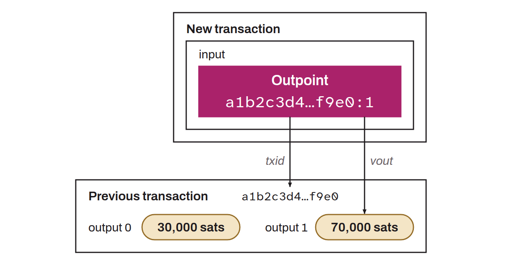

Unique reference to a transaction output. It consists of two elements:
* `txid`: the identifier of the transaction that created the output;
* `vout`: the index of the output in the transaction.

The combination of these two elements identifies a transaction output precisely. For example, if a transaction has a `txid` of `abc...123` and the output index is `0`, the outpoint is written:



```text
abc...123:0
```

The outpoint is used in the inputs (`vin`) of a new transaction to indicate which UTXO is being spent.

*The term “outpoint” refers to a simple reference, which can point to an output that has already been spent. A UTXO is an unspent output, so an outpoint is not a synonym of “UTXO”.*
