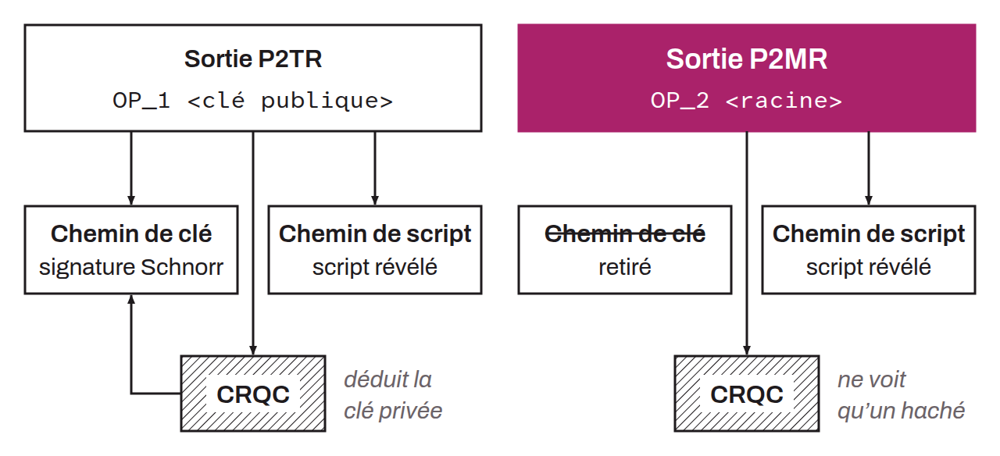

Acronym for *Pay-to-Merkle-Root*. Output type proposed by BIP-0360 that takes P2TR without its key path spend: the output commits only to the Merkle root of a script tree, not to a public key. As long as the funds stay on the output, it therefore hands no public key to a quantum computer capable of recovering a private key from a public key (CRQC). BIP-0360 plans SegWit version 2 for P2MR, with addresses that start with `bc1z`.

To understand what P2MR changes, it helps to start from P2TR. A P2TR output contains a public key, obtained by tweaking an internal key with a hash that combines that key and the root of the script tree. It is spent in 2 ways: through the key path, where a single Schnorr signature for that key is enough, or through the script path, where one of the scripts in the tree is revealed and then satisfied. Yet this public key is visible on the blockchain from the moment the funds are received, and stays visible as long as they do not move. A CRQC could derive the private key from it with Shor's algorithm, then spend the funds through the key path. BIP-0360 calls this scenario a long exposure attack: the attacker has all the time the funds remain on the output.

P2MR removes this key path, and with it the internal key. Let's take an example. Alice wants to receive bitcoin on a P2MR output. Her wallet writes 2 scripts, which form the leaves of the tree: the first, `<Alice's public key> OP_CHECKSIG`, requires a signature from Alice; the second serves as a fallback path, a slot a wallet will be able to give, in the outputs it creates, to a post-quantum signature script the day Bitcoin offers one. The wallet hashes each leaf (`TapLeaf` tagged hash), then the pair of hashes (`TapBranch`), exactly as for P2TR (BIP-0341). It obtains a 32-byte root and places it as is in the `scriptPubKey`: `OP_2 OP_PUSHBYTES_32 <root>`, where `OP_2` indicates SegWit version 2. Encoded in `Bech32m`, this output gives a `bc1z` address, such as `bc1zzmv50jjgxxhww6ve4g5zpewrkjqhr06fyujpm20tuezdlxmfphcqfc80ve`, the example from BIP-0360. As long as Alice does not spend, the blockchain shows only a hash.

To spend, Alice reveals the leaf she uses. Her witness contains her signature, the script of the first leaf, and a control block: one byte that carries the leaf version, followed by the Merkle path, here the hash of the second leaf. Each node recomputes the hash of the revealed leaf, combines it with the hashes of the path until it obtains a root, and compares it with the root recorded in the output. If they are identical and the tree has at least 2 leaves, it executes the script under the Tapscript rules (BIP-0342), which here amounts to verifying Alice's signature. The second leaf stays hidden: only its hash appears. The control block is $1 + 32m$ bytes, where $m$ is the depth of the leaf in the tree, against $33 + 32m$ for P2TR, which must add the internal key.

This protection has a cost in space. According to the calculations in BIP-0360, the simplest safe P2MR spend (tree of depth 1, leaf `<key> OP_CHECKSIG`) takes 135 bytes of witness, against 66 for a P2TR key path spend, which contains only a signature, a difference of 69 bytes. Against an equivalent P2TR script path spend, the P2MR witness is on the contrary at least 32 bytes lighter, since there is no internal key left to reveal. A P2MR output and a P2TR output, for their part, are exactly the same size.

The choice to start from P2TR rather than P2WSH comes down to Tapscript. P2WSH, which also shows only a hash before the spend, already resists long exposure, but it supports neither Tapscript nor its `OP_SUCCESSx` opcodes, which allow much freer opcodes than the old `OP_NOP` ones to be added by soft fork, and therefore, one day, post-quantum signature verification opcodes. With P2MR, Bitcoin would have a second script tree output type after P2TR, and existing Tapscript scripts carry over to it almost unchanged. A wallet that uses only the P2TR key path moves to P2MR with an `OP_CHECKSIG` leaf, provided it adds a second leaf, because a tree reduced to a single leaf can be spent by anyone.

P2MR protects only against long exposure. At the moment Alice spends, her public key appears in the witness of the transaction, which waits for confirmation in the mempool. A quantum computer fast enough to recover the private key during that short window could sign a competing transaction that sends the funds elsewhere: this is the short exposure attack. BIP-0360 estimates that protecting against it could require post-quantum signatures, and refers to a separate proposal. The protection also falls as soon as the public key of a leaf is known by another route, for example when the same key has already been used in a spent output: BIP-0360 points out that extended public keys (xpub) and wallet descriptors also reveal public keys.

Since version 0.12.0 of BIP-0360 (June 18, 2026), a tree reduced to a single leaf (depth 0) is spent without its script being executed: revealing the leaf is enough. Such an output can therefore be spent by anyone as soon as its leaf is known, and a miner who sees it pass in a spend attempt can send the funds to themselves. This rule is intentional: it pushes wallets to always provide at least 2 leaves, one of them a fallback, instead of saving the 32 bytes of the Merkle path, and it keeps the depth 0 case for a future soft fork.

P2MR would be added by soft fork. To a node that does not know P2MR, a SegWit version 2 output belongs to the versions reserved for future upgrades: Bitcoin Core classifies it as `WITNESS_UNKNOWN`, its consensus rules accept a spend of it without checking its witness, and its relay policy refuses to relay a transaction that spends it. A soft fork can therefore restrict these spends without old nodes rejecting the blocks of upgraded nodes. Version 2 is not reserved for P2MR, however: in 2026, Fabian Jahr's cross-input signature aggregation (CISA) proposal targets the same one, and reviewers, including Mark Erhardt, expect the first proposal to be activated to take the next free version.

The very principle of P2MR is debated. On July 27, 2026, Pieter Wuille opens a thread on Delving Bitcoin that lists the candidate post-quantum output types, including P2MR and P2TRv2, an output that takes the P2TR rules and adds post-quantum signature opcodes, and whose elliptic curve paths could be disabled later within that single output type. He prefers P2TRv2 for a simple migration before Q-day, then a type derived from P2MR over the longer term, and sees P2MR as the choice of informed users who want to hide their public keys. According to the Optech newsletter of October 2, 2026, Wuille considers that neither P2TRv2 nor P2MR protects on its own, since each depends on a decision to abandon elliptic curve (secp256k1) signatures: P2MR leaves that decision to the owner, but address reuse and public key sharing seem to him too widespread for most users to benefit. Conduition, on the contrary, defends P2MR in the same thread: it allows funds to be kept safe without depending on the timeline of a possible disabling of these signatures.

The idea of a P2TR output stripped of its key path is old. On July 7, 2021, on the bitcoin-dev mailing list, Jeremy Rubin already considers disabling this path to protect funds with Lamport signatures built using `OP_CAT`. BIP-0360 has a different origin: on June 8, 2024, Hunter Beast publishes on Delving Bitcoin a first draft named P2QRH (*Pay-to-Quantum-Resistant-Hash*), which assigns SegWit version 3 to a quantum-resistant signature algorithm. Number 360 is assigned to it on December 18, 2024. In July 2025, the proposal becomes a P2TR without a key path and moves to SegWit version 2. Its version 0.10.0, which the changelog dates September 17, 2025, renames it P2TSH (*Pay-to-Tapscript-Hash*), then it becomes P2MR on February 10, 2026 and enters the BIP repository the next day. As of October 25, 2026, BIP-0360 is at version 0.12.1, in Draft status, with Hunter Beast, Ethan Heilman, and Isabel Foxen Duke as authors, and Bitcoin Core's code does not implement P2MR.

*The former names P2QRH and P2TSH refer to the same proposal at earlier stages. Not to be confused: P2MR is the output type, BIP-0360 is the document that specifies it.*
