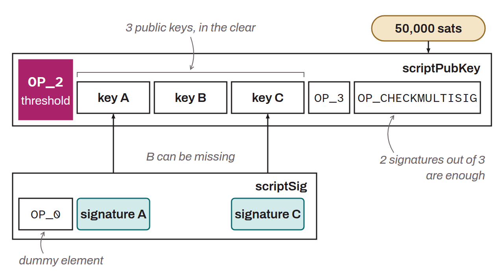

Acronym for *Pay to Multisig*. Standard script template used to set spending conditions on a UTXO. It locks bitcoin to several public keys. To spend that bitcoin, signatures must be provided with a predefined number of the associated private keys. For example, a `P2MS 2/3` has `3` public keys with `3` associated secret private keys. To spend the bitcoin locked with this P2MS script, a signature must be made with at least `2` of the `3` private keys. It is a threshold security system.

This script was standardized in 2011 by Gavin Andresen, with the publication of BIP-0011, shortly after he had taken over maintenance of Bitcoin's main client. The `OP_CHECKMULTISIG` opcode, on which it relies, already existed in the original Bitcoin source code, but scripts that used it were nonstandard before this proposal. Today, P2MS is used only marginally by a few applications. The vast majority of modern multisignatures use other scripts such as P2SH, P2WSH, or P2TR. Compared with these, P2MS is extremely basic. The public keys that make it up are revealed as soon as the transaction is received. Using a P2MS is also more expensive than the other multisignature scripts.

*P2MS outputs are often called “bare multisig”. In early 2023, P2MS scripts were at the center of a controversy because of their misuse within the Stamps protocol. Their impact on the UTXO set was notably singled out.*
