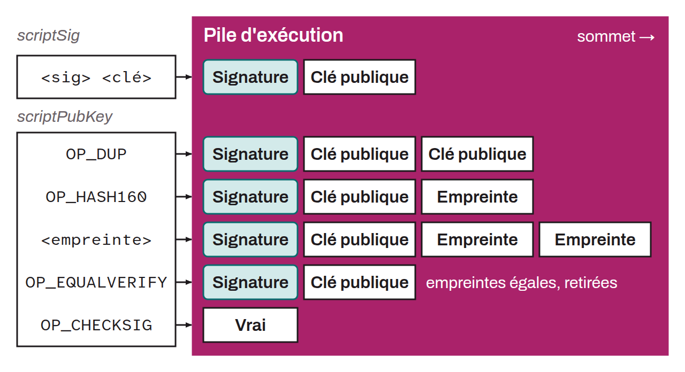

Acronym for *Pay to Public Key Hash*. Standard script template used to set spending conditions on a UTXO. It locks bitcoin to a hash of a public key, that is, to a receiving address. This script is associated with the Legacy standard, and was introduced in the earliest versions of Bitcoin by Satoshi Nakamoto.

Unlike P2PK, where the public key is explicitly included in the script, P2PKH uses a cryptographic hash of the public key. This script includes the `RIPEMD160` hash of the `SHA256` of the public key and stipulates that, to access the funds, the recipient must provide a public key matching this hash, along with a valid digital signature generated from the associated private key. P2PKH addresses are encoded using the `Base58Check` format, which makes them robust against typing errors thanks to a checksum. On mainnet, these addresses begin with the digit `1` (with `m` or `n` on testnet).

