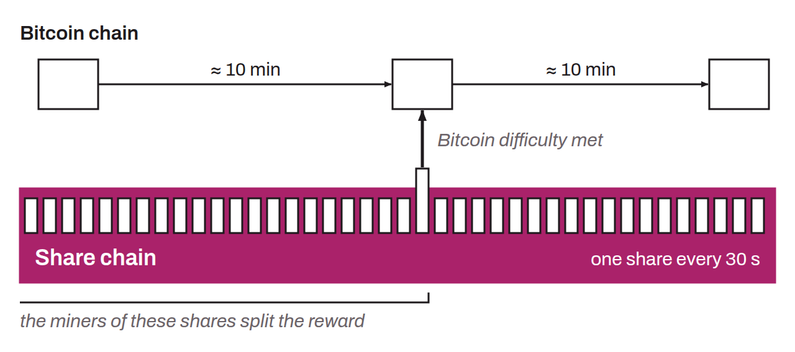

Decentralized mining pool protocol for Bitcoin, designed to eliminate the need for a central operator. P2Pool works by creating a secondary blockchain called the “share chain”, whose difficulty is adjusted to produce a block roughly every 30 seconds. The blocks of this share chain are structurally identical to those of the Bitcoin blockchain, but with a lower difficulty target. Each miner runs their own P2Pool node connected to a full Bitcoin node and contributes to the share chain's peer-to-peer network.

When one of the share chain's blocks also meets the difficulty required by the Bitcoin network, it is broadcast on the Bitcoin network. The block reward is then distributed among the miners who contributed the most recent shares in the share chain. This mechanism guarantees that the distribution of rewards is proportional to each miner's contribution, without a central operator controlling the funds or the selection of transactions.

P2Pool was created in 2011 by Forrest Voight. It saw significant adoption in the early years of Bitcoin, but its use declined in the face of the growth of centralized pools, which offered simpler interfaces and lower variance for individual miners. The last block mined by P2Pool dates from 2019.
