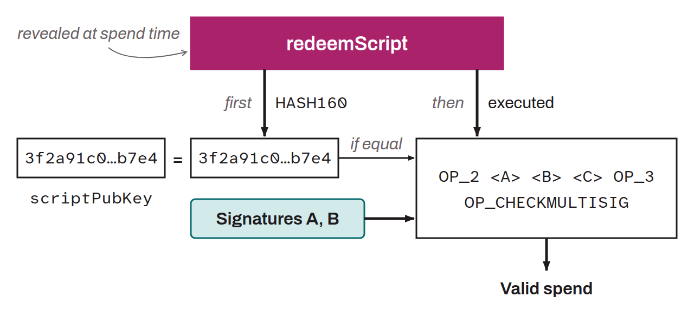

Acronym for *Pay to Script Hash*. Standard script template used to set spending conditions on a UTXO. Unlike the P2PK and P2PKH scripts, where the spending conditions are predefined, P2SH allows arbitrary spending conditions and additional features to be built into a transaction script.

Technically, in a P2SH transaction, the `scriptPubKey` contains the cryptographic hash of a `redeemScript`, rather than explicit spending conditions. This hash is obtained using a `HASH160` hash, that is, a `SHA256` followed by a `RIPEMD160`. When bitcoin is sent to a P2SH address, the underlying `redeemScript` is not revealed. Only its hash is included in the transaction. P2SH addresses are encoded in `Base58Check` and begin with the digit `3` on mainnet (with `2` on testnet). When the recipient wants to spend the bitcoin received, they must provide a `redeemScript` matching the hash found in the `scriptPubKey`, along with the data needed to satisfy the conditions of that `redeemScript`. For example, in a multisig P2SH, the script could require signatures from several private keys.

Using P2SH gives more flexibility, because it allows arbitrary scripts to be built without the sender knowing their details. P2SH was introduced in 2012 with BIP-0016.
