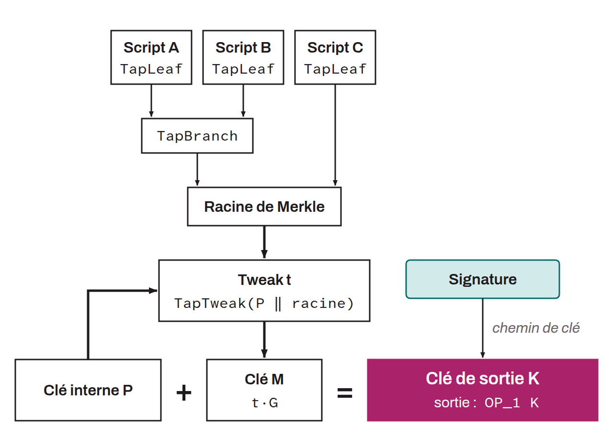

Acronym for *Pay to Taproot*. Standard script template used to set spending conditions on a UTXO. It was introduced with the implementation of Taproot in November 2021. P2TR uses the Schnorr protocol to aggregate cryptographic keys, as well as Merkle trees for alternative scripts, known as MAST (*Merkelized Alternative Script Tree*). Unlike traditional transactions, where the spending conditions are publicly exposed (sometimes at receipt, sometimes at spend time), P2TR can hide complex scripts behind a single apparent public key.

Technically, a P2TR script locks bitcoin to a single Schnorr public key, named $K$. However, this key $K$ is actually an aggregate of a public key $P$ and a public key $M$, the latter being computed from $P$ and the Merkle root of a script tree, each leaf of which is a script (TapLeaf). Bitcoin locked with a P2TR script can be spent in two distinct ways: either by publishing a valid signature for the key $K$ (produced with the private key of $P$ adjusted by the same tweak), or by satisfying one of the scripts contained in the Merkle tree. The first option is called the key path and the second the script path.

P2TR thus lets users send bitcoin either to a public key or to several scripts of their choice. Another advantage of this script is that, although there are multiple ways to spend a P2TR output, only the one that is used has to be revealed at spend time, which lets the unused alternatives remain private. P2TR is a SegWit version 1 output, which means that the signatures for P2TR inputs are stored in the witness of a transaction, not in the `scriptSig`. P2TR addresses use a `Bech32m` encoding and begin with `bc1p`.
