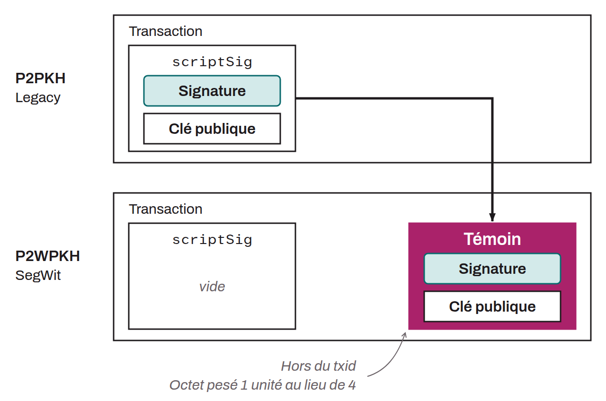

Acronym for *Pay to Witness Public Key Hash*. Standard script template used to set spending conditions on a UTXO. P2WPKH was introduced with the implementation of SegWit in August 2017.

This script is similar to P2PKH (*Pay to Public Key Hash*), since it also locks bitcoin based on the hash of a public key, that is, a receiving address. The difference lies in how signatures and scripts are included in the transaction. With P2WPKH, the signature script information (`scriptSig`) is moved out of the traditional structure of the transaction into a separate section called the `Witness`. This move is a feature of the SegWit (*Segregated Witness*) upgrade that prevents signature-related malleability. P2WPKH transactions are generally cheaper in fees than Legacy transactions, because the witness portion costs less.

P2WPKH addresses are written using the `Bech32` encoding, with a checksum in the form of a BCH code. These addresses always begin with `bc1q`. P2WPKH is a SegWit version 0 output.
