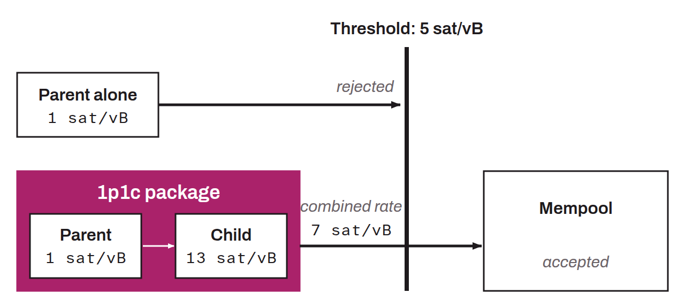

Improvement to Bitcoin's relay protocol that lets nodes relay and evaluate groups of interdependent transactions collectively, rather than processing them individually. Without this mechanism, a parent transaction whose fee rate is too low to be accepted into the mempool is rejected, which prevents any child transaction from being used for CPFP (*Child Pays For Parent*), since the parent is needed to validate it.

This problem is particularly critical for time-sensitive protocols such as the Lightning Network, where transactions are signed well before they are broadcast. The minimum fee rate a node accepts depends on the content of its mempool at a given moment; a parent transaction that was previously eligible for CPFP may therefore no longer be so by the time it is broadcast.

Package relay solves this problem by evaluating the combined fee rate of a parent-child set. The current implementation in Bitcoin Core focuses on a limited variant of one parent and one child (1p1c), which requires no change to the P2P protocol. BIP-0331 formalizes the more general specification of ancestor package relay. The main development challenge lies in preventing denial-of-service vulnerabilities.

This mechanism complements anchor outputs and is an important countermeasure against transaction pinning attacks.
