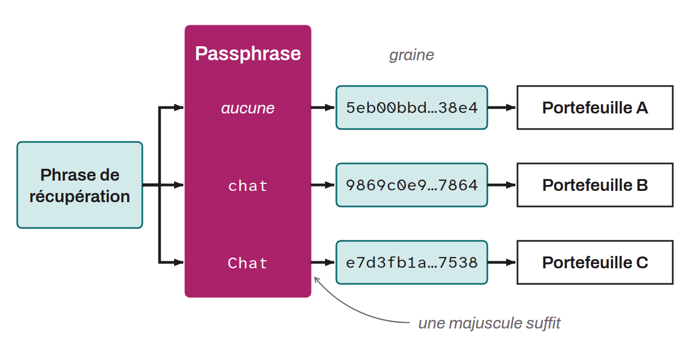

Optional password that, combined with the mnemonic phrase, offers an extra layer of security for hierarchical deterministic Bitcoin wallets. HD wallets are generally generated from a mnemonic phrase of 12 or 24 words. This mnemonic phrase is very important, because it makes it possible to restore all of a wallet's keys in case of loss. However, it is a single point of failure (SPOF). If it is compromised, the bitcoin is in danger. This is where the passphrase comes in. It is an optional password, chosen by the user, that is added to the mnemonic phrase to strengthen the wallet's security. Not to be confused with a PIN code or an ordinary password, the passphrase plays a role in deriving the cryptographic keys.

It works in tandem with the mnemonic phrase, modifying the seed from which the keys are generated. Thus, even if someone obtains the mnemonic phrase, they cannot access the funds without the passphrase. Using a passphrase essentially creates a new wallet with distinct keys. Changing the passphrase, even slightly, generates a different wallet.

The passphrase is arbitrary and can be any combination of characters chosen by the user. Using a passphrase offers several advantages. First, it reduces the risks tied to a compromise of the mnemonic phrase by requiring a second factor to access the funds. Second, it can be used strategically to create decoy wallets holding small amounts of bitcoin, in case of physical coercion to steal the funds. Finally, it is useful when the user wants to control the randomness of the HD wallet's seed generation. The passphrase must be complex enough to resist brute-force attacks and must be backed up reliably. Losing the passphrase can mean being unable to access the funds, just like losing the mnemonic phrase.

*The passphrase is sometimes also called “two-factor seed phrase”, “password”, “seed extension”, “extension word”, or “13th or 25th word”. Note that there are two types of passphrases on Bitcoin. The best known is the one described above, which depends on BIP-0039 and secures an entire HD wallet. However, BIP-0038 also specified a way to secure a single private key with a passphrase. This second type of passphrase is hardly used anymore today.*
