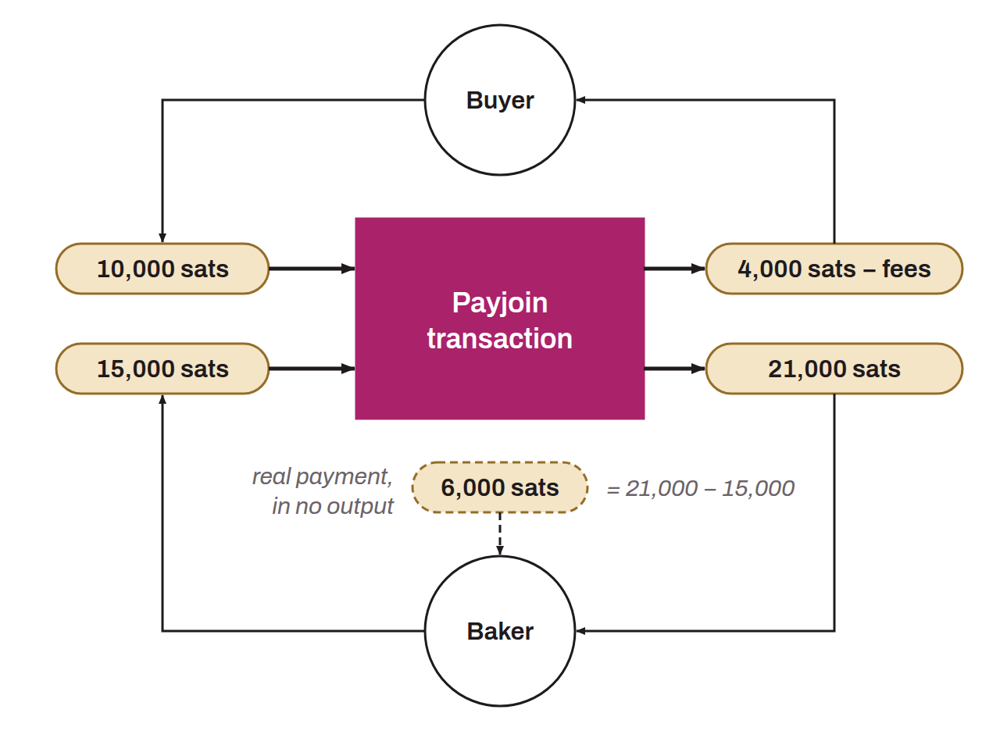

Specific Bitcoin transaction structure that improves users' privacy when spending, by collaborating with the payment recipient. What sets Payjoin apart is its ability to generate a transaction that looks ordinary at first glance but is in reality a mini coinjoin between two people. To do this, the structure of the transaction brings the payment recipient into the inputs alongside the real sender. The recipient thus includes a payment to itself in the middle of the very transaction that pays them. For example, if Alice buys a baguette for `6,000 sats` using a `10,000 sats` UTXO and opts for a Payjoin, the baker adds to the inputs a `15,000 sats` UTXO of their own, which they get back in full as an output, in addition to Alice's `6,000 sats`.

The Payjoin transaction serves two purposes. First, it aims to mislead an outside observer by creating a decoy in chain analysis based on the common-input-ownership heuristic (CIOH). Usually, when a transaction on the blockchain has several inputs, it is assumed that all these inputs likely belong to a single entity. Thus, when an analyst examines a Payjoin transaction, they are led to believe that all the inputs come from one person. This perception is wrong, however, because the payment recipient also contributes inputs alongside the real payer. Second, Payjoin also fools an outside observer about the real amount of the payment. By examining the structure of the transaction, the analyst might believe that the payment equals the amount of one of the outputs. In reality, the payment amount matches none of the outputs. It is in fact the difference between the recipient's output UTXO and the recipient's input UTXO. In this respect, the Payjoin transaction falls within the field of steganography. It can hide the real amount of a transaction within a fake transaction that acts as a decoy.

*Payjoin is also sometimes called “P2EP (Pay-to-End-Point)”, “Stowaway”, or “steganographic transaction”.*
