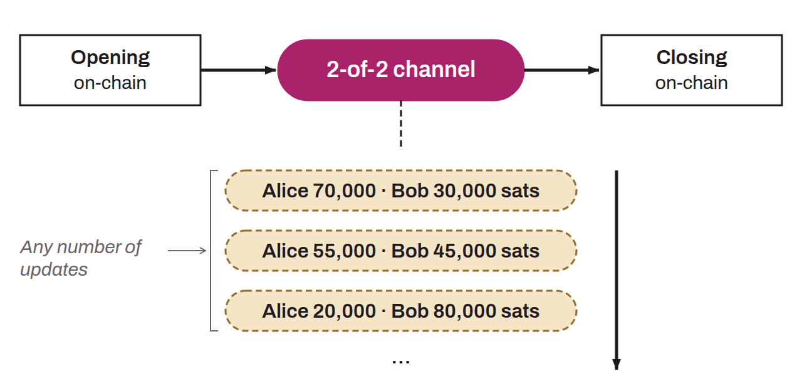

Bidirectional connection between two Lightning nodes that allows bitcoin to be exchanged off-chain on the Lightning Network. On-chain, a payment channel is represented by a 2-of-2 multisig address held by the two participants. The payment channel requires one on-chain transaction to open and another to close. Between these two events, the users of the channel can make a very large number of off-chain bitcoin exchanges on the Lightning Network, without any on-chain activity. On Lightning, a payment can be routed through several channels and several nodes, to send bitcoin without necessarily opening a direct channel with the recipient.

