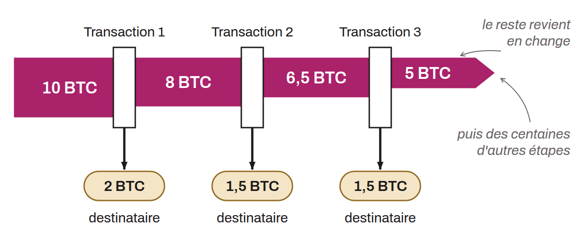

Transaction pattern on the blockchain in which a large amount of bitcoin is gradually distributed through a long series of successive transactions. At each step, a fraction is sent to a recipient, while the remainder goes back to a new change address. The residual balance thus shrinks from transaction to transaction: each amount is "peeled" off the remaining total. The chain can extend over hundreds, even thousands, of transactions.

This pattern is characteristic of automated withdrawals from exchanges, mining pools, or payment services, but it is also used for money laundering, since the small individual amounts attract less attention from compliance systems.

In chain analysis, the peeling chain is an easy pattern to identify, because each transaction generally has only one input and two outputs with very asymmetric amounts. Identifying it makes it possible to follow the thread of payments and to reconstruct the flows of funds from a single source.
