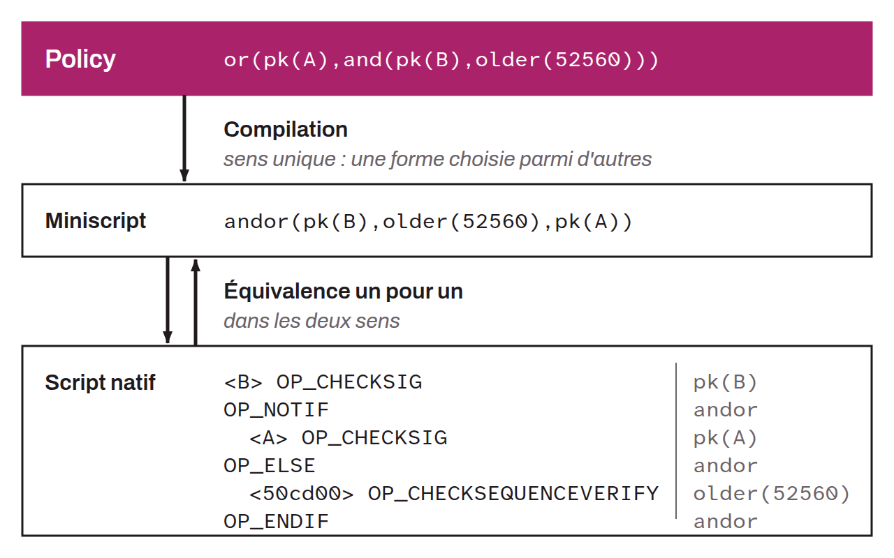

High-level, user-oriented language for simply specifying the conditions under which a UTXO can be unlocked, within Miniscript. A policy is an abstract description of spending rules. It can then be compiled into miniscript, which maps one-to-one onto operations of Bitcoin's native script language.



The policy language is slightly different from the miniscript language. For example, imagine a security setup with key A as the primary path and key B as the recovery path, but under a timelock of one year (about 52,560 blocks). As a policy, this would be:

```plaintext
or(pk(A),and(pk(B),older(52560)))
```

Once compiled into miniscript, it would be:

```plaintext
andor(pk(B),older(52560),pk(A))
```

And once converted into native script, it would be:

```plaintext
<B>
OP_CHECKSIG
OP_NOTIF
<A>
OP_CHECKSIG
OP_ELSE
<50cd00>
OP_CHECKSEQUENCEVERIFY
OP_ENDIF
```
