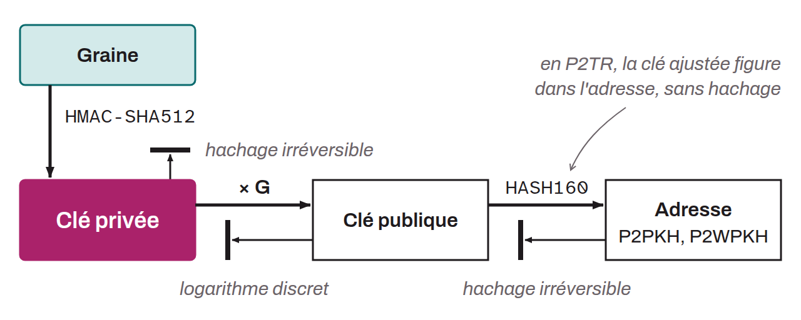

Fundamental element of asymmetric cryptography: a number (256 bits in Bitcoin) that represents a cryptographic secret. This key is used to digitally sign transactions and prove possession of a Bitcoin public key (and by extension of a receiving address) by satisfying a `scriptPubKey`. Private keys thus make it possible to spend bitcoin by unlocking the UTXOs associated with the corresponding public key. Private keys must be kept strictly confidential, since their disclosure could allow malicious third parties to take control of the associated funds.

In the Bitcoin system, the private key is linked to a public key by a multiplication on the secp256k1 elliptic curve: the public key is the point obtained by multiplying the generator point G by the private key. This pair is then used to sign with an elliptic-curve digital signature algorithm (ECDSA or Schnorr). The public key is derived from the private key, but the reverse is practically impossible because of the computational difficulty inherent in solving the underlying mathematical problem (the discrete logarithm problem). The public key is generally used to generate a Bitcoin address, which serves to lock bitcoin using a script. In cryptography, private keys are often random or pseudorandom numbers. In the specific context of Bitcoin hierarchical deterministic wallets, private keys are derived deterministically from the seed. Private keys are frequently confused with the seed or with the mnemonic phrase. Yet these elements are quite different.

*The term “private key” is sometimes abbreviated “privkey” or “PV”.*
