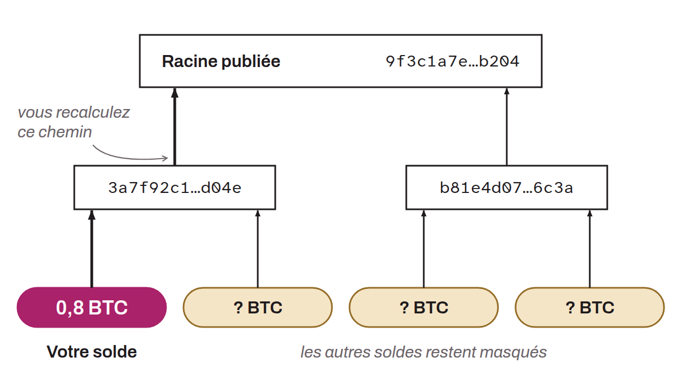

Mechanism used by bitcoin exchanges to demonstrate that they actually hold their customers' assets. The goal is to prove the company's solvency by verifying that its bitcoin equals or exceeds the user balances it is supposed to hold.

Exchanges often use Merkle trees that include all of their users' balances. Each user can then verify that their balance is part of the total set, without revealing information about the other accounts. In parallel, the exchange publicly signs the addresses that secure the bitcoin to prove that it controls them.

However, these methods have significant limits, because proof of possession of funds does not prove the company's solvency. The exchange could, for example, secretly take on debt through collateralized loans secured by the same bitcoin used in the proof of reserves. It could also display a balance of borrowed bitcoin while remaining insolvent. The problem with proof of reserves is that it focuses only on verifying the exchange's assets, without taking its liabilities into account.

Traditionally in Bitcoin, to celebrate the anniversary of the publication of the genesis block, every January 3 is "Proof-of-Key Day." Bitcoin holders are invited to all withdraw their funds from exchanges and store them in self-custody wallets, in order to test the solvency of these platforms.

But in the end, the only real protection against the risk of an exchange going bankrupt is to keep one's bitcoin in self-custody.
