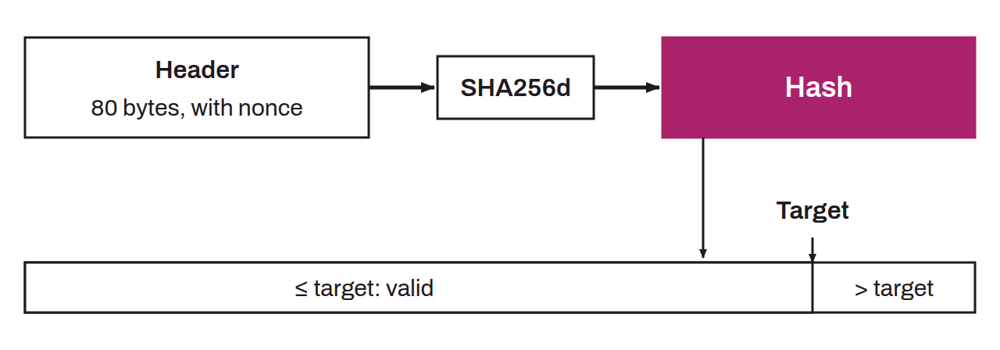

Protection mechanism against Sybil attacks, which are characterized by the multiplication of fake identities in order to gain an illegitimate advantage. Proof of work thus establishes a non-negligible marginal cost to multiplying votes on Bitcoin. Proof of work is the foundation of Nakamoto consensus, the principle used to establish agreement on a single version of the distributed ledger among the nodes of the network. Concretely, proof of work is the search for a value that, when passed through a mathematical function whose output is random, gives a result less than or equal to a target number. This proof-of-work target is adjusted every 2,016 blocks by the nodes. This is what is called the difficulty adjustment. The target number is lowered to increase mining difficulty, or raised to lower it, depending on how the computing power deployed by miners changed over the previous period.

This work performed by miners is rewarded with each valid block found. The winning miner pockets a monetary reward, made up of the block subsidy (the creation of new bitcoin ex nihilo) and transaction fees. In 2026, the difficulty of proof of work on Bitcoin is such that mining requires great computing power to win blocks. As a result, it is often necessary to have chips specialized in running `SHA256d`, called ASICs, and to join mining pools.
