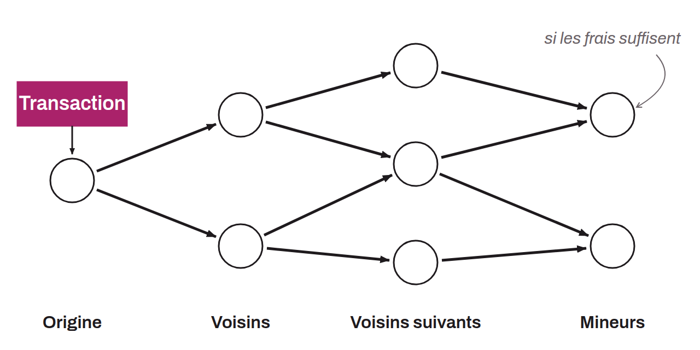

Process by which information, such as transactions and blocks, is passed from node to node across the Bitcoin network. When a user makes a transaction, it is first verified by the node the user is connected to. After validation, the transaction is relayed to the other nodes connected to that node, which in turn verify it and propagate it. Quickly, a large portion of the network's nodes become aware of the transaction. If it pays enough fees, miners include it in their candidate block. When a block containing this transaction is validated, the transaction is confirmed.

