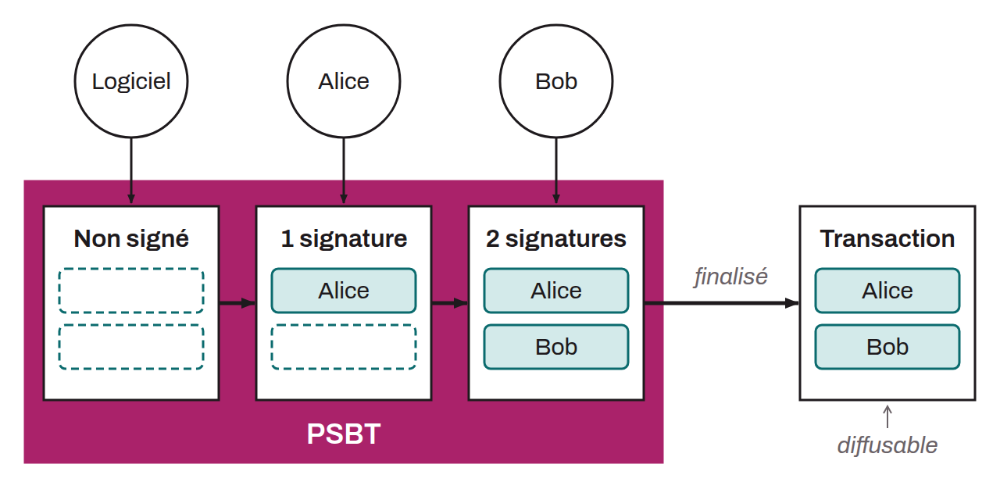

Acronym for Partially Signed Bitcoin Transaction. Specification introduced with BIP-0174 to standardize how unfinalized transactions are built in Bitcoin software such as wallets. A PSBT encapsulates a transaction in which the inputs may not be fully signed. It includes all the information a participant needs to sign the transaction without requiring additional data. A PSBT can thus take three different forms:
* A fully constructed transaction, but not yet signed;
* A partially signed transaction, where some inputs are signed while others are not yet;
* Or a fully signed Bitcoin transaction, which can be converted into a transaction ready to be broadcast on the network.

The PSBT format facilitates interoperability between different wallet software and signing devices (hardware wallets). Version 0 of PSBTs is defined in BIP-0174, and version 2 in BIP-0370. Since Bitcoin Core 32.0, the PSBT RPCs create version 2 PSBTs by default.

*PSBT version 1 does not exist. Since version 0 was the first version, the second version was informally called version 2. Ava Chow, who wrote BIP-0370, therefore decided to give this new version the number 2 to avoid any confusion.*
