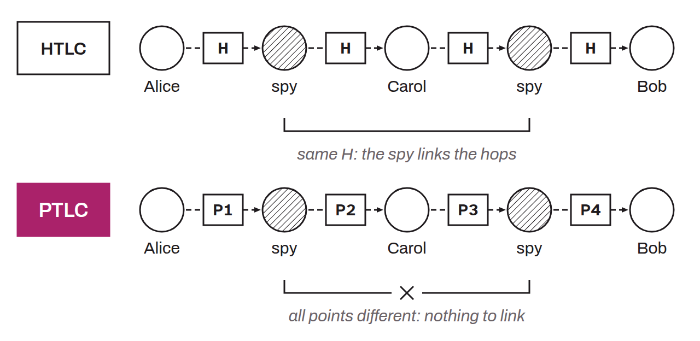

Conditional contracts designed to replace HTLCs (Hashed Time-Locked Contracts) for routing payments on the Lightning Network. A PTLC (Point Time-Locked Contract) works on the same principle as an HTLC (locking funds that are released only if a cryptographic condition is met) but uses elliptic curve points and signatures instead of hashes and preimages.

In an HTLC, all the hops of a single payment share the same hash. A spy node present on several hops can correlate the payments and identify that they belong to the same transaction. PTLCs eliminate this problem: each hop uses a different public key/signature pair, which makes payments untraceable from one hop to the next.

The mechanism relies on adaptor signatures, a construction made practical by Schnorr signatures. The recipient provides a point (a public key) to the sender. At each hop, a new secret is added through key aggregation, so that revealing the final signature compromises only the local secret, not the relationship between hops. If a PTLC is published on-chain, it appears as an ordinary Taproot spend, indistinguishable from a regular payment.

Beyond privacy, PTLCs reduce the block space used and open the way to new constructions such as stuckless payments, which make it possible to retry a stuck payment with no risk of paying twice. Their deployment requires changes to the Lightning protocol and depended on the availability of Schnorr signatures, activated with Taproot in 2021.
