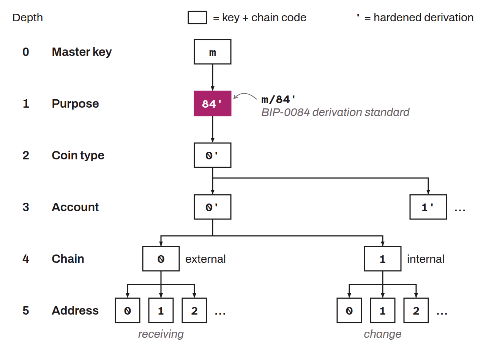

In hierarchical deterministic (HD) wallets, the purpose, defined by BIP-0043, is a specific derivation level. This index, located at the first depth of the derivation tree (`m / purpose' /`), identifies the derivation standard adopted by the wallet, in order to ease compatibility between different wallet software. For example, in the case of SegWit addresses (BIP-0084), the purpose is noted `/84'/`. This method makes it possible to organize keys efficiently across the different address types within a single HD wallet. The standard indexes used are:
* For P2PKH: `44'`;
* For P2WPKH-nested-in-P2SH: `49'`;
* For P2WPKH: `84'`;
* For P2TR: `86'`.

