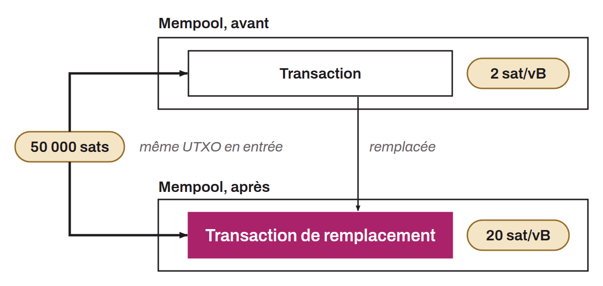

Transaction mechanism that lets the sender replace a transaction with another one paying higher fees, to speed up its confirmation. If a transaction with fees that are too low remains stuck, the sender can use Replace-by-Fee to increase the fees and prioritize the replacement transaction in mempools.

RBF is possible as long as the transaction is in mempools; once in a block, it can no longer be replaced. When first sent, the transaction can signal that it may be replaced by setting the `nSequence` value to less than `0xfffffffe`. This is known as an RBF "flag." This parameter signals that the transaction can be updated after its broadcast, which later allows an RBF. This signal was required for a replacement to be accepted. Since Bitcoin Core 28.0, nodes accept replacements by default even if RBF was not initially signaled (full RBF): the `mempoolfullrbf` option, which allowed enabling it since Bitcoin Core 24.0.1, was removed in Bitcoin Core 29.0.

Unlike CPFP (Child Pays For Parent), where it is the recipient who can act to speed up the transaction, RBF (Replace-by-Fee) lets the sender take the initiative to speed up their own transaction by increasing the fees.
