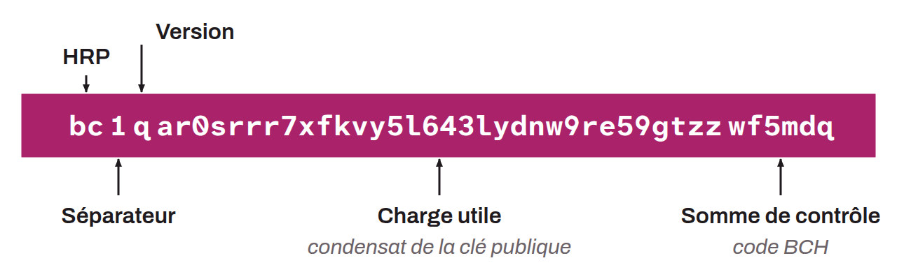

Piece of information used to receive bitcoin. An address is generally built by hashing a public key with `SHA256` and `RIPEMD160`, and adding metadata to that digest. The public keys used to build a receiving address are part of the user's wallet and are therefore derived from its seed. For example, SegWit addresses are made up of the following elements:
* An HRP designating “bitcoin”: `bc`;
* A separator: `1`;
* The SegWit version used: `q` or `p`;
* The payload: the hash digest of the public key (or the public key itself in the case of Taproot);
* The checksum: a BCH code.

But a receiving address can also represent something else, depending on the script template used. For example, P2SH addresses are built from the hash of the script. Taproot addresses, on the other hand, directly contain the tweaked public key, without hashing it.

A receiving address can be represented as an alphanumeric string or as a QR code. Each address can be used multiple times, but this is strongly discouraged. To maintain a certain level of privacy, each Bitcoin address should be used only once, and a new one should be generated for every incoming payment to the wallet. An address is encoded with `Bech32` for SegWit v0 addresses, with `Bech32m` for SegWit v1 addresses, and with `Base58check` for legacy addresses. From a technical standpoint, receiving bitcoin amounts to owning the private key associated with a public key (and therefore with an address). When someone receives bitcoin, the sender updates the existing spending condition so that only the recipient now holds the power to spend it.
