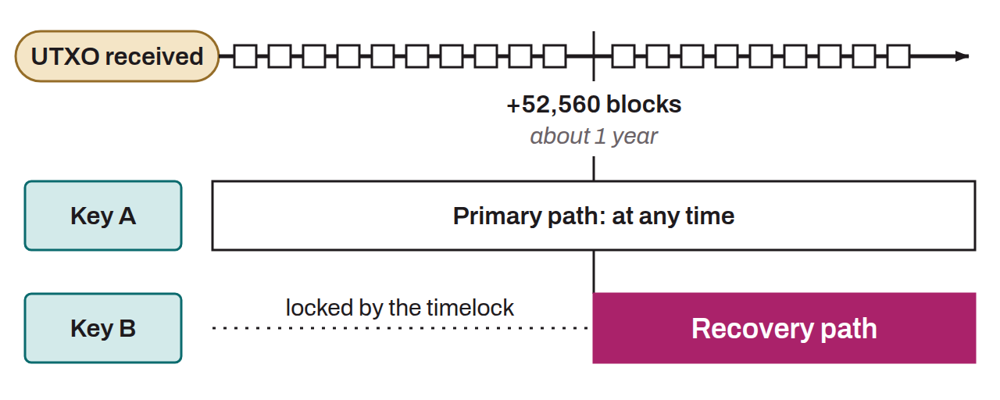

In wallet software that uses Miniscript, such as Liana, the recovery paths are sets of keys that become operational only after a period of inactivity defined in the script that locks the bitcoin (timelock). Recovery paths can be used only once the timelocks have expired, and thus provide a way to recover funds when the primary path is unavailable. Take a script that includes 2 distinct keys: key A, which authorizes immediate spending of the bitcoin, and key B, which can spend it after a delay defined by a timelock of 52,560 blocks. In this example, key A comes from the primary path, while key B comes from the recovery path.

