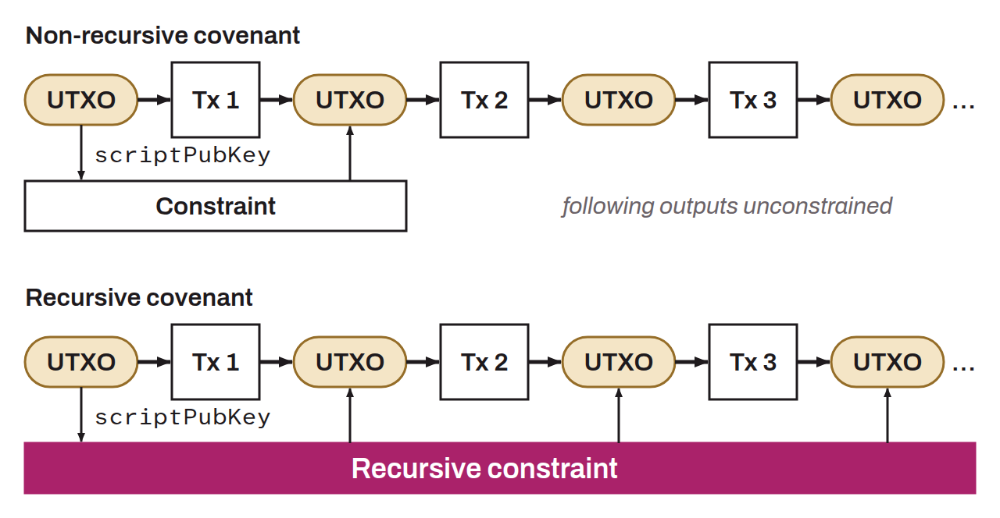

Type of smart contract on Bitcoin that imposes conditions not only on the current transaction, but also on the future transactions that spend the outputs of this transaction. This makes it possible to create chains of transactions where each must follow certain rules defined by the first one in the chain. Recursion creates a sequence of transactions where each inherits the restrictions of its parent transaction. This would make it possible to establish complex, long-term control over how bitcoin can be spent, but it would also introduce risks to spending freedom and fungibility.

In short, a non-recursive covenant limits itself to the transaction that immediately follows the one that established the rules. A recursive covenant, by contrast, can impose specific conditions on a bitcoin indefinitely. Transactions can follow one another, but the bitcoin in question always keeps the initial conditions attached to it. Technically, a non-recursive covenant is established when the `scriptPubKey` of a UTXO defines restrictions on the `scriptPubKey` of the outputs of a transaction that spends that UTXO. A recursive covenant, on the other hand, is established when the `scriptPubKey` of a UTXO defines restrictions on the `scriptPubKey` of the outputs of a transaction that spends that UTXO, and on all the `scriptPubKey` that will follow the spending of that UTXO.

More generally, in computer science, “recursion” is the ability of a function to call itself, which creates a kind of endless nesting.
