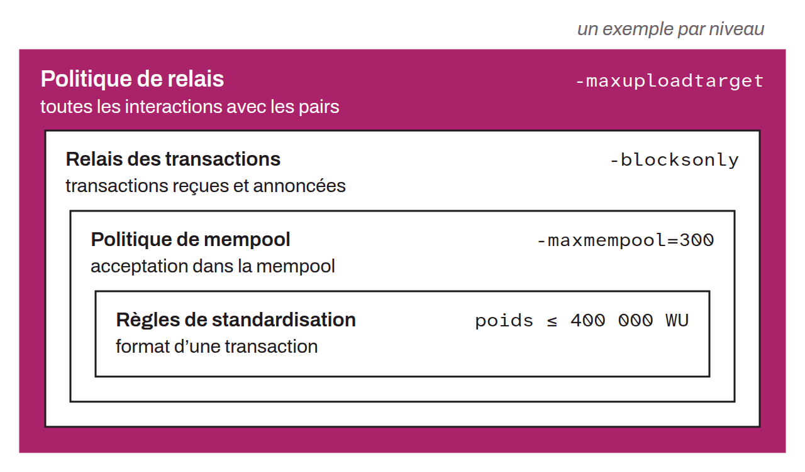

Set of all the rules observed by a Bitcoin node's software in its interactions with the peer-to-peer network. Relay policy is the broadest term for a node's local rules, as opposed to the consensus rules, which are universal.

Relay policy breaks down into increasingly specific subsets:
* Transaction relay policy covers specifically the rules for handling transactions on the network;
* Mempool policy gathers the rules for accepting transactions into the node's mempool;
* Standardness rules dictate the format of the individual transactions that are accepted.

Unlike the consensus rules, relay policy is configured locally by each node and can vary from one node to another.
