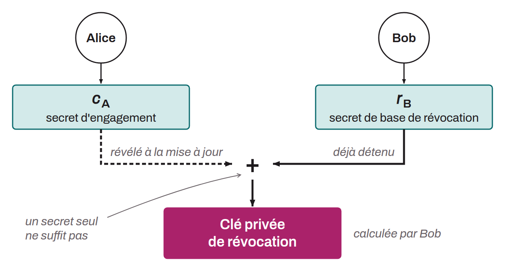

Cryptographic key used in the Lightning Network to make it possible to punish a peer that publishes an old channel state. Each commitment transaction contains a `to_local` output that offers two spending paths:
* one subject to a relative delay (`OP_CHECKSEQUENCEVERIFY`) for the owner,
* the other immediately spendable by the counterparty if it holds the corresponding revocation key.

The revocation key is built collaboratively. For a given commitment transaction, Alice provides a commitment point ($C_A$) and Bob provides a revocation base point ($R_B$). The revocation public key is computed as follows:
$$Rev\ =\ R_B \cdot SHA256(R_B\ \Vert\ C_A)\ +\ C_A \cdot SHA256(C_A\ \Vert\ R_B)$$

Neither Alice nor Bob can derive the corresponding private key alone. When the channel state is updated, Alice reveals the secret $c_A$ associated with her commitment point. Bob can then combine $c_A$ with his own secret $r_B$ to obtain the revocation private key and, if needed, build a penalty transaction.

