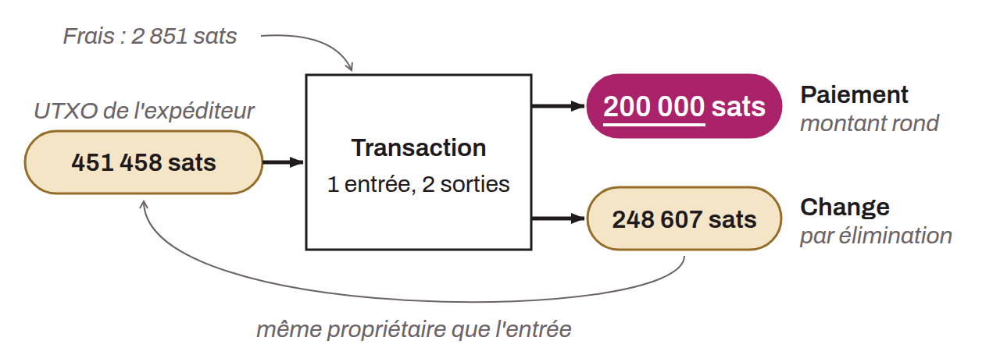

Internal chain analysis heuristic on Bitcoin that makes it possible to form a hypothesis about the nature of a transaction's outputs based on round amounts. In general, when facing a simple payment pattern (one or more inputs and 2 outputs), if one of the outputs spends a round amount, then it represents the payment. By elimination, if one output represents the payment, the other represents the change. It can therefore be inferred that the user behind the inputs likely still holds the output identified as the change.

This heuristic does not always apply, since most payments are still made in fiat units of account. Indeed, when a merchant in France accepts bitcoin, it generally does not display stable prices in sats. It will rather opt for a conversion between the price in euros and the amount of bitcoin to be paid, using its POS (such as BTCPay Server, for example). There should therefore be no round number in the outputs of the transaction. Nevertheless, an analyst could try to perform this conversion by taking into account the exchange rate in force when the transaction was broadcast on the network. If bitcoin one day becomes the preferred unit of account in exchanges, this heuristic could become even more useful for analysis.

