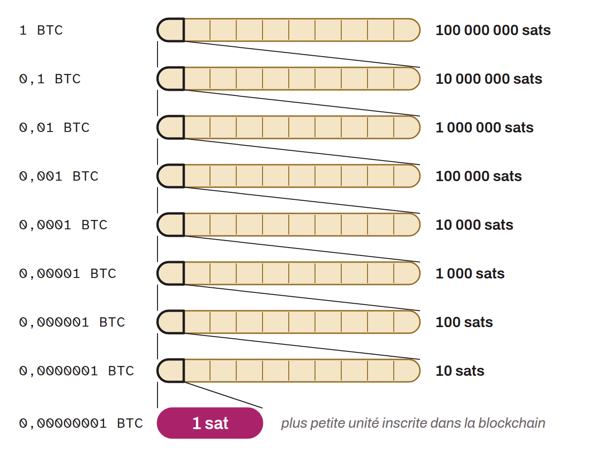

Smallest subdivision of bitcoin that can be recorded on the blockchain, often abbreviated "sat". It is named in honor of Bitcoin's inventor, Satoshi Nakamoto. A single bitcoin is divided into 100,000,000 sats, meaning that one satoshi equals 0.00000001 bitcoin. Because of its small unit value, the sat is often used to set prices, especially for small transactions. It is often preferred to BTC on the Lightning Network.

