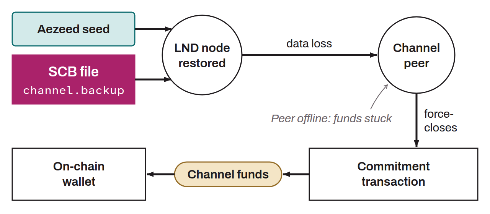

Backup mechanism introduced by LND that makes it possible to recover one's funds after data loss on a Lightning node. The SCB is a file (usually named `channel.backup`, not to be confused with the `channel.db` file) that contains static information about open channels: peer identities, ways to contact them, and channel identifiers.

Unlike the `channel.db` database, which changes with every payment, the SCB is updated only when a channel is opened or closed. It contains neither the detailed channel state nor the transaction history. The SCB therefore cannot restore a Lightning node as it was: its role is to ask peers to force-close the channels so that the funds can be recovered on-chain.

During a restoration, the user provides their aezeed seed (to recreate the on-chain wallet) and the SCB file. LND then contacts each peer to tell it about the data loss. The peer broadcasts its latest commitment transaction to close the channel, and the funds reappear in the on-chain wallet. This mechanism depends on the cooperation and availability of peers: if a peer is offline or uncooperative, the funds in the channel concerned can remain stuck indefinitely.

