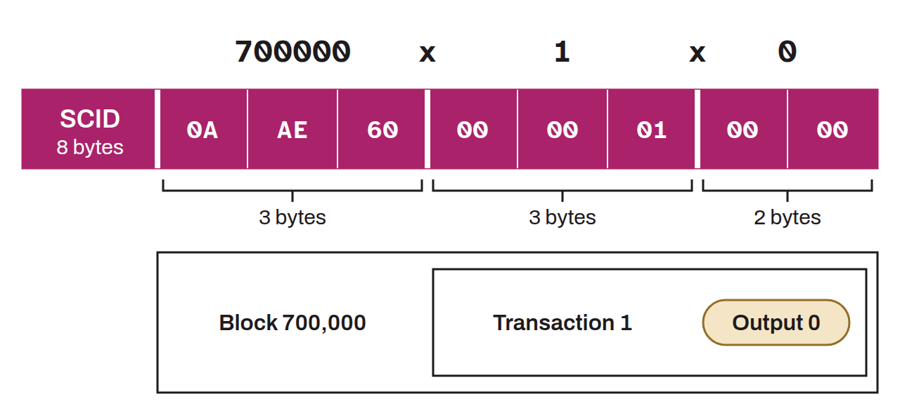

Compact identifier used on the Lightning Network to uniquely reference a payment channel. Rather than using the public keys of the two nodes or the full txid of the funding transaction, the SCID encodes the channel's exact position in the blockchain in a condensed format.

The SCID is made of three elements concatenated over 8 bytes: the number of the block containing the funding transaction (3 bytes), the index of that transaction in the block (3 bytes), and the index of the output corresponding to the channel (2 bytes). For example, an SCID `700000x1x0` means: block 700,000, transaction 1, output 0.

